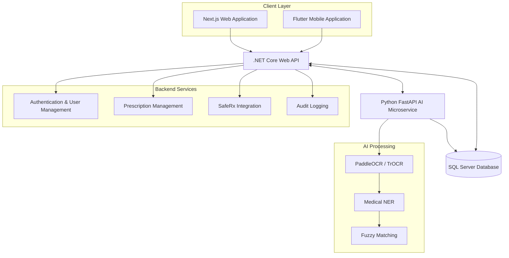

 <div align="center">

# 🩺 Roshta | روشتة
### AI-Powered Clinical Decision Support for Egyptian Prescriptions

<p>
  <strong>Bridging AI, Pharmacy, and Patient Safety.</strong>
</p>

<p>
  
  
  
  
  
  
</p>

<p>
  
  
  
</p>

</div>

---

## 📖 Overview

**Roshta (روشتة)** is an AI-powered web and mobile clinical decision-support platform designed to assist pharmacists in Egypt.

The platform addresses real-world challenges in prescription processing by combining AI-powered handwriting recognition, medical entity extraction, drug interaction screening, and affordable generic medication recommendations.

With support for handwritten and code-switched Arabic/English prescriptions, Roshta transforms traditional prescription interpretation into a smarter, safer, and more accessible workflow.

> 🛡️ **Safety First**
>
> Roshta does not make autonomous medication substitutions or dispensing decisions. It provides intelligent recommendations and clinical alerts while keeping the pharmacist in control of every final decision.

## 📑 Table of Contents

- [🎯 Core Problems](#-core-problems)
- [✨ Key Features](#-key-features)
- [🏗️ System Architecture](#️-system-architecture)
- [📂 Repository Structure](#-repository-structure)
- [⚙️ Getting Started](#️-getting-started)
- [🧠 Data Sources & AI Models](#-data-sources--ai-models)
- [📚 Project Documentation](#-project-documentation)
- [👥 The Team](#-the-team)
- [⚠️ Disclaimer](#️-disclaimer)

---

## 🎯 Core Problems

Roshta addresses three major challenges in the Egyptian pharmaceutical workflow:

| Challenge | Problem | Our Approach |
|---|---|---|
| 🔬 **Technical Gap** | Traditional OCR engines struggle with cursive, non-standardized Arabic/Latin medical handwriting. | Specialized handwriting recognition and medical NLP. |
| 🛡️ **Safety Gap** | Pharmacists must manually identify potentially dangerous drug-drug interactions. | Automated interaction screening and clinical alerts. |
| 💰 **Economic Gap** | Patients may pay more for imported brands despite the availability of affordable local generics. | Generic alternatives discovery and medication comparison. |

---

## ✨ Key Features

### 1. 📸 Prescription Processing

An intelligent prescription digitization workflow:

- Capture or upload handwritten prescriptions.
- Detect prescription layout and individual text regions.
- Recognize Arabic and Latin handwritten medication names.
- Extract medication entities and relevant details.
- Match extracted names against the Egyptian drug registry.
- Allow pharmacists to review and correct AI-generated results before confirmation.

### 2. 🔍 Drug Search & Interaction Screening

A dedicated search mode for pharmacists handling walk-in patients.

- Search and retrieve medication information.
- Identify potential drug-drug interactions.
- Highlight interaction severity.
- Provide relevant clinical warnings through SafeRx API integration.

### 3. 💊 Affordable Generic Alternatives

- Discover available local generic medications.
- Compare medication alternatives.
- Identify potentially more affordable bioequivalent options.
- Keep all substitution decisions under pharmacist supervision.

### 4. 🧠 AI-Powered Recognition Pipeline

A multi-stage AI pipeline designed specifically for complex medical handwriting.

```text
Prescription Image
        │
        ▼
┌──────────────────────┐
│  Layout Segmentation │
│      PaddleOCR       │
└──────────────────────┘
        │
        ▼
┌──────────────────────┐
│ Handwriting          │
│ Recognition (TrOCR)  │
└──────────────────────┘
        │
        ▼
┌──────────────────────┐
│ Medical Entity       │
│ Extraction (NER)     │
└──────────────────────┘
        │
        ▼
┌──────────────────────┐
│ Fuzzy Drug Matching  │
│     RapidFuzz        │
└──────────────────────┘
        │
        ▼
┌──────────────────────┐
│ Pharmacist Review    │
│ & Confirmation       │
└──────────────────────┘
```

### 5. 🛑 Clinical Safety Gate

Roshta incorporates a safety mechanism for potentially dangerous drug interactions.

- Detect major interactions through SafeRx API.
- Display warnings before prescription confirmation.
- Require explicit pharmacist acknowledgment through a mandatory safety checkbox.
- Record acknowledgment events in the audit trail.

### 6. 🌍 Bilingual Experience

- Full Arabic and English interface.
- Right-to-left (RTL) layout support.
- Consistent medical terminology presentation.
- Responsive web and mobile experiences.

### 7. 🔒 Privacy & Security

- JWT-based authentication.
- Role-based access control.
- Audit logging for critical actions.
- No persistent storage of patient medical histories or personal identifiers.
- Designed with Egypt's Personal Data Protection Law (151/2020) in mind.

---

## 🏗️ System Architecture

Roshta follows a microservice-oriented architecture, with the .NET backend serving as the central API layer between client applications, the database, and the AI service.



### Technology Stack

| Layer | Technology | Responsibility |
|---|---|---|
| Web Frontend | Next.js | Responsive interface and RTL support |
| Mobile Frontend | Flutter | Cross-platform pharmacist application |
| Backend | .NET 8 / ASP.NET Core Web API | Business logic, authentication, APIs, and integrations |
| AI Service | Python / FastAPI | OCR, NER, and fuzzy medication matching |
| Database | PostgreSQL | Application data and prescription records |
| Authentication | JWT | Secure authentication and authorization |
| Drug Interaction | SafeRx API | Medication interaction screening |
| OCR | PaddleOCR / TrOCR | Layout analysis and handwriting recognition |
| NLP | Medical NER | Medication entity extraction |
| Matching | RapidFuzz | Approximate medication name matching |

---

## 📂 Repository Structure

```text
Roshta/
│
├── web/                     # Next.js frontend
│   ├── app/
│   ├── components/
│   ├── public/
│   └── package.json
│
├── mobile/                  # Flutter application
│   ├── lib/
│   ├── assets/
│   └── pubspec.yaml
│
├── backend/                 # ASP.NET Core Web API
│   ├── Controllers/
│   ├── Services/
│   ├── Models/
│   ├── Data/
│   └── Program.cs
│
├── ai-service/              # Python FastAPI microservice
│   ├── models/
│   ├── services/
│   ├── pipelines/
│   ├── main.py
│   └── requirements.txt
│
├── docs/                    # Project documentation
│   ├── SRS/
│   ├── ERD/
│   ├── API/
│   └── System-Design/
│
└── README.md
```

---

## ⚙️ Getting Started

Follow these instructions to set up Roshta locally.

### Prerequisites

Make sure you have the following installed:

| Requirement | Version |
|---|---|
| Node.js & npm | v18+ |
| Flutter SDK | v3+ |
| .NET SDK | .NET 8 |
| Python | 3.10+ |
| PostgreSQL | Supported release |

### 1. Backend Setup (.NET)

```bash
cd backend

# Configure your database connection in appsettings.json

dotnet restore

dotnet ef database update

dotnet run
```

### 2. AI Microservice Setup (Python)

```bash
cd ai-service

# Create virtual environment
python -m venv venv

# Activate virtual environment

# Windows
venv\Scripts\activate

# Linux / macOS
source venv/bin/activate

# Install dependencies
pip install -r requirements.txt

# Start FastAPI server
uvicorn main:app --reload --port 8000
```

### 3. Web Application Setup (Next.js)

```bash
cd web

# Install dependencies
npm install

# Start development server
npm run dev
```

### 4. Mobile Application Setup (Flutter)

```bash
cd mobile

# Install dependencies
flutter pub get

# Run application
flutter run
```

---

## 🧠 Data Sources & AI Models

### 💊 Egyptian Drug Registry

- **Dataset:** Eg-drugs.
- **Coverage:** 25,000+ Egyptian medication records.
- **Source:** Open-source GitHub datasets.
- **Purpose:** Medication identification, lookup, and generic alternatives discovery.

### 🛡️ Drug Interaction Screening

- **Integration:** SafeRx API.
- **Purpose:** Detect potentially dangerous drug-drug interactions and provide clinical alerts.

### 🤖 AI Models & Technologies

| Component | Technology | Purpose |
|---|---|---|
| Layout / OCR | PaddleOCR | Prescription layout segmentation and text detection |
| Handwriting Recognition | Microsoft TrOCR | Handwritten text recognition |
| Base Model | `microsoft/trocr-base-handwritten` | Handwriting recognition, with planned Egyptian-data fine-tuning |
| Medical NLP | Arabic/Medical NER | Medication entity extraction |
| Fuzzy Matching | RapidFuzz | Medication name matching |

---

## 📚 Project Documentation

All detailed academic and technical documentation is maintained in the `/docs` directory.

| Document | Description |
|---|---|
| 📄 Software Requirements Specification (SRS) | Functional and non-functional requirements |
| 🗺️ Entity Relationship Diagram (ERD) | Database structure and relationships |
| 🔗 REST API Specification | API endpoints and integration contracts (OpenAPI/Swagger) |
| 🏗️ System Design Document | Architecture and technical design decisions |

---

## 👥 The Team

<div align="center">

### 🚀 Team Synapse
**Faculty of Computers and Information — Graduation Project 2027**

</div>

| Role | Team Members |
|---|---|
| 👑 Team Lead | Semon Hany |
| ⚙️ Backend (.NET) | Abear Atef, Mohamed Hamdon, Marcos Adel |
| 💻 Frontend (Next.js) | Aya Sayed, Eman Ahmed, Manar Abead |
| 📱 Mobile (Flutter) | Mohamed Erian, Semon Hany |
| 🧠 AI & Data (Python) | Mostafa Mohamed |
| 🎨 UI/UX Designer | Aya AbdElrahem |

---

## ⚠️ Disclaimer

Roshta is developed as an academic graduation project and is intended exclusively as a **clinical decision-support tool**.

The AI models, medication recommendations, and interaction screening features are designed to assist healthcare professionals and do not replace the professional judgment of licensed pharmacists or physicians.

- AI-generated medication information must always be reviewed.
- Drug interactions must be verified against reliable medical references.
- Generic alternatives must be evaluated for appropriate equivalence.
- Final dispensing and substitution decisions remain the responsibility of the licensed pharmacist.

**Patient safety always comes first.**

---

<div align="center">

### ❤️ Built with passion by Team Synapse

*Making prescription processing smarter, safer, and more accessible.*

**Roshta | روشتة — Graduation Project 2027**

</div>
